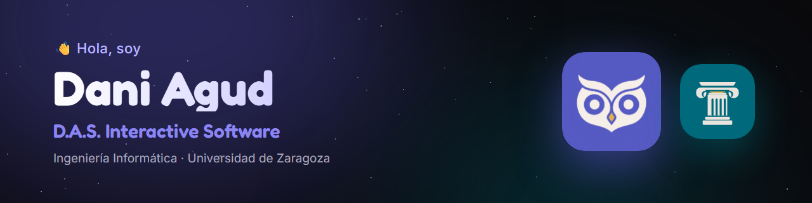

  

Estudiante de **3.º de Ingeniería Informática** en la **Universidad de Zaragoza**, en la rama de **Ingeniería del Software**. Bajo el nombre de **D.A.S. Interactive Software** diseño, programo y publico mis propias apps, de la idea a la tienda.

---

## 🦉 Atenea · proyecto principal

**Agenda y calendario de tareas.** Abres la app y empiezas a anotar: sin registrarte, sin configurar nada y sin necesitar internet. Y cuando quieras tener tus tareas también en el ordenador, inicias sesión con Google y se sincronizan solas. Gratis, sin anuncios y sin vender tus datos.

📖 **Toda la información, las descargas y la documentación completa están en [atenea.sbs](https://atenea.sbs).**

### ✨ Qué la hace diferente

- 🔒 **Local por defecto.** Sin cuenta, tus tareas viven en tu dispositivo y nada sale de él.
- ☁️ **La nube, solo si la quieres.** Inicia sesión con Google y tus tareas son las mismas en el móvil, el ordenador y el navegador, sincronizadas en tiempo real.
- ⚡ **Sin fricción.** Crear una tarea lleva segundos: título, fecha, hora y prioridad, y listo.
- 💸 **Gratis de verdad.** Sin suscripciones, sin funciones de pago y sin anuncios.

### 🧩 Lo que puedes hacer

- 📅 **Tareas completas:** fecha, horario de inicio y fin, descripción y prioridad alta, media o baja, cada una con su color.
- 🗓️ **Muchas formas de ver tu tiempo:** en el móvil, mes clásico, vista compacta y calendario continuo; en el ordenador, vistas de día, semana, mes y año. Con los festivos nacionales marcados.
- 🔔 **Recordatorios** en el móvil, también para lo que creas desde el ordenador, y autocompletado opcional de las tareas cuya hora ya pasó.
- 🔗 **Google Calendar:** trae los eventos de los calendarios que elijas como tareas, siempre al día y en solo lectura.
- 📤 **Importa y exporta `.ics`** para llevarte tus tareas a cualquier calendario, sin duplicados al importar dos veces.
- 📱 **Widgets para Android:** el mes completo y las tareas del día en la pantalla de inicio, para marcarlas o añadir una nueva sin abrir la app.
- 🎨 **A tu gusto:** tema claro y oscuro, y el color principal que prefieras.
- 🚀 **Actualizaciones automáticas** en la app de escritorio, con una pantalla de arranque que descarga e instala la nueva versión en segundos.

### 🛠️ Cómo está hecha

| Pieza | Tecnología |
|---|---|
| 📱 App de Android | Flutter · Dart · Riverpod |
| 💻 Web y escritorio (Windows y Linux) | React · TypeScript · Vite · Tauri v2 (Rust), con el mismo código para las dos |
| ☁️ Cuentas y sincronización | Firebase Authentication · Cloud Firestore, con reglas que aíslan los datos de cada usuario |
| 🌐 Web oficial | Astro · Tailwind CSS · GSAP, en Firebase Hosting, con ambientaciones de Halloween, Navidad y el Día de la Hispanidad |
| 📦 Distribución | Google Play · GitHub Releases (`.exe`, `.deb`, `.rpm`, AppImage) con actualizaciones firmadas · GitHub Actions |

### 🗺️ Lo que viene

- 🍎 **iPhone y Mac**, sincronizados con tu cuenta como el resto.
- 👥 **Amigos:** compartir tareas y enviároslas, para que un plan o un recado que os toca a los dos aparezca en el calendario de cada uno.

**Síguela en**
[Instagram](https://www.instagram.com/atenea_agenda/) ·
[YouTube](https://www.youtube.com/@Atenea-Agenda-Oficial) ·
[X](https://x.com/atenea_agenda) ·
[Facebook](https://www.facebook.com/profile.php?id=61595429762871)

---

## 🏛️ Hércules

**Monitor y optimizador del sistema** para Windows, Linux y macOS. Una app de escritorio ligera, rápida y cuidada al detalle para saber qué está pasando en tu ordenador y ponerle remedio, sin consumir los recursos que viene a vigilar.

- 📊 **Panel en tiempo real:** uso de la CPU núcleo a núcleo, RAM, disco y red, actualizado cada 2 segundos.
- 🧾 **Gestor de procesos:** lista ordenable y filtrable, con opción de terminar los que se cuelgan o consumen de más.
- 🧹 **Mantenimiento con un clic:** limpieza de archivos temporales y liberación de caché y memoria RAM.
- 🖥️ **Multiplataforma de verdad:** detecta el sistema operativo y adapta su comportamiento a Windows, Linux o macOS.
- 🎨 **Interfaz moderna:** ventana translúcida con desenfoque, modo claro y oscuro, color de acento libre y transparencia ajustable.

👉 [Ver el repositorio](https://github.com/danimnr/hercules) · [Descargar la última versión](https://github.com/danimnr/hercules/releases/latest) (Windows, `.deb` y `.rpm`)

---

## 🧰 Tecnologías

---

## 📬 Contacto

✉️ [dasinteractivesoftware@gmail.com](mailto:dasinteractivesoftware@gmail.com)  
☕ [Ko-fi](https://ko-fi.com/danidev_mnr): si te gusta lo que hago, puedes invitarme a un café
